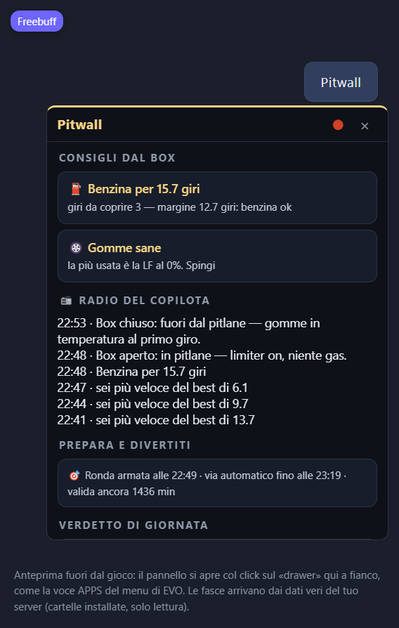
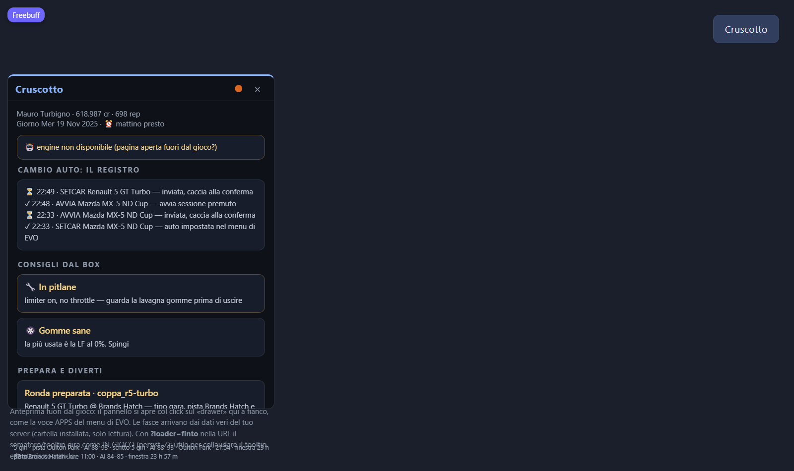

# Post breve da subreddit — r/assettocorsaevo

> Taglio corto dal post lungo (POST-PRESENTAZIONE-IT.md, 1/11). La versione
> breve IN INGLESE vive qui accanto:
> [POST-PRESENTAZIONE-SUBREDDIT-EN.md](POST-PRESENTAZIONE-SUBREDDIT-EN.md). Le due foto
> del fondo della versione lunga stavano QUI in testa: nel subreddit la prima
> cosa che si vede è l'immagine. Caricate a mano su Reddit
> (`docs/screenshots/in-diretta/pitwall.png` e `cruscotto.png`, nell'ordine:
> Pitwall prima, Cruscotto dopo), il secondo testo va come immagine #2 / commento.

---

*(Anteprime dell'interfaccia v0.1.45, rese fuori dal gioco sul server
vero — la fascia «engine non disponibile» della seconda immagine è il
marchio: in gioco non compare.)*

**Pitwall (ac-evo-career) — la carriera di AC EVO gestita dal desktop, e in pista parla il copilota in italiano**

https://github.com/turbignox-hash/ac-evo-career

Gratuita, open source, aggiornata da sola. La costruisco da mesi tra una gara e l'altra — ecco cosa fa:

- **Carriera vera per EVO**: campionati generati da un sorteggio riproducibile dentro il catalogo del gioco — il tab si chiama «Pools sorteggiati a sorte dal catalogo» (5 livelli, serie monomarca e multiclasse, zavorre e penalità calcolate dal ΔPI con cap 20% — niente a occhio).
- **La griglia si scrive DAVVERO nel gioco**: Pitwall sceglie le AI, le mette in griglia e scrive i customgrid dei weekend; ogni scrittura va su disco solo dopo backup e verifica.
- **Il meccanico toglie il «che pressione metto?»**: legge la telemetria dei TUOI giri, consiglia pressioni/aero/benzina e scrive il `.carsetup` che EVO accetta a caldo, senza riavvio.
- **🌉 Ponte tra piste**: il base setup dell'auto si copia nella pista dove non era mai stata — senza riaprire il setup da zero.
- **Copilota a voce, sempre italiano**: delta, benzina, metà gara, meteo — te li dice a voce durante la sessione: niente da leggere mentre guidi.
- **In gioco girano DUE app nostre**: il **Cruscotto** (sedile, gare del giorno, mini-classifica della ronda viva, orologio di giornata) e il **Pitwall** (la radio del copilota durante la sessione).
- **Nomi dei piloti editabili** (rinomina singola o in blocco), tutto cliccabile stile Football Manager: auto, piloti, piste, serie.
- **Save al sicuro**: backup prima di ogni import, no doppioni, verifica integrità con riparazioni sicure.
- **Libro PB** per auto×pista e giro ideale dai settori migliori di sempre.

Installazione a un file (`installa.cmd`); release [v0.1.45](https://github.com/turbignox-hash/ac-evo-career/releases/tag/v0.1.45) su GitHub con 697 test verdi.

Lo provi e ti inciampi in qualcosa? Issues su GitHub o qui sotto — grazie!
