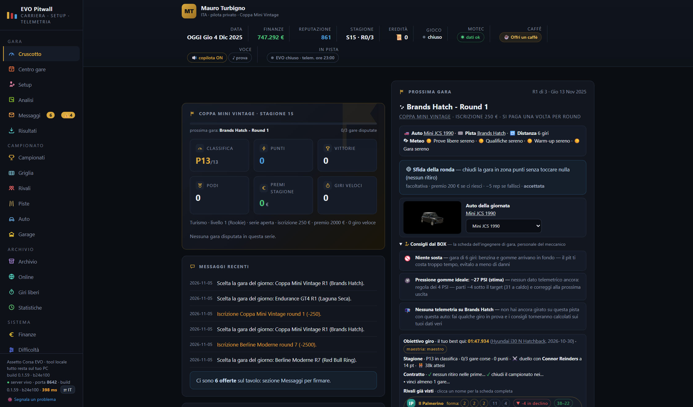
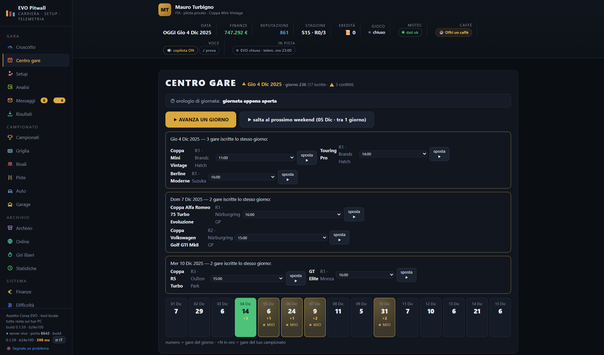
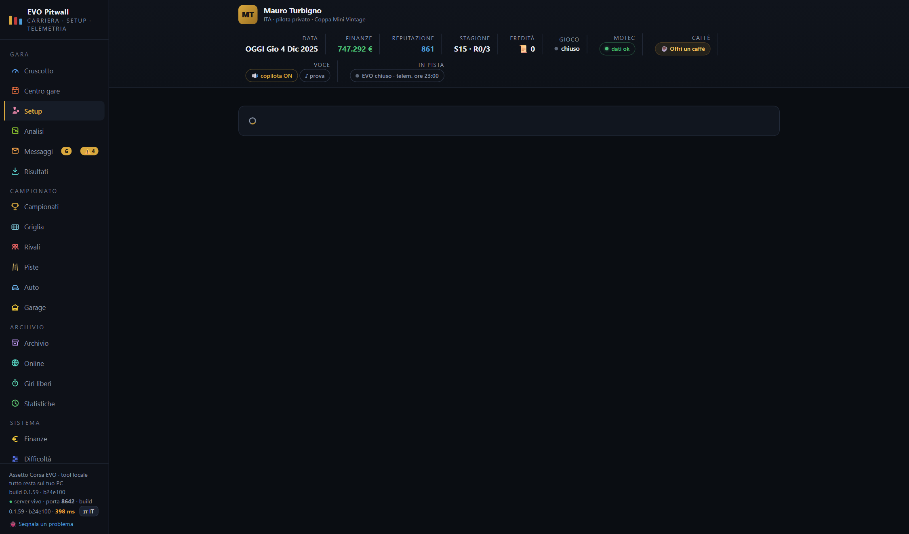
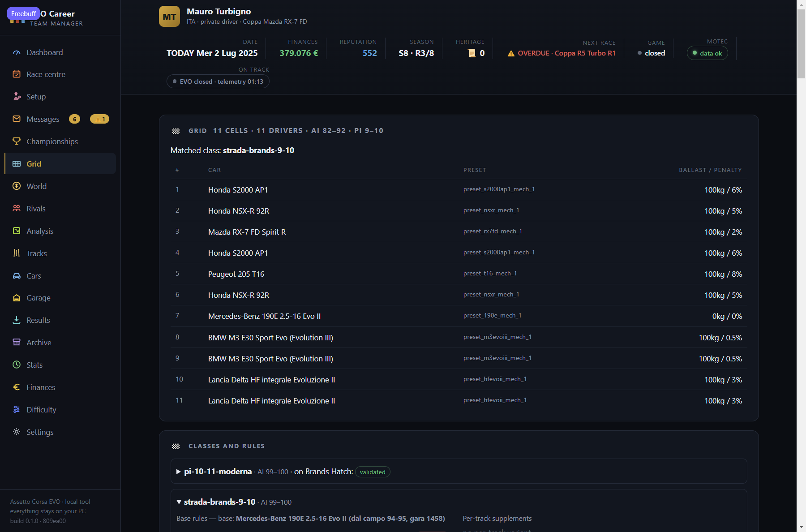
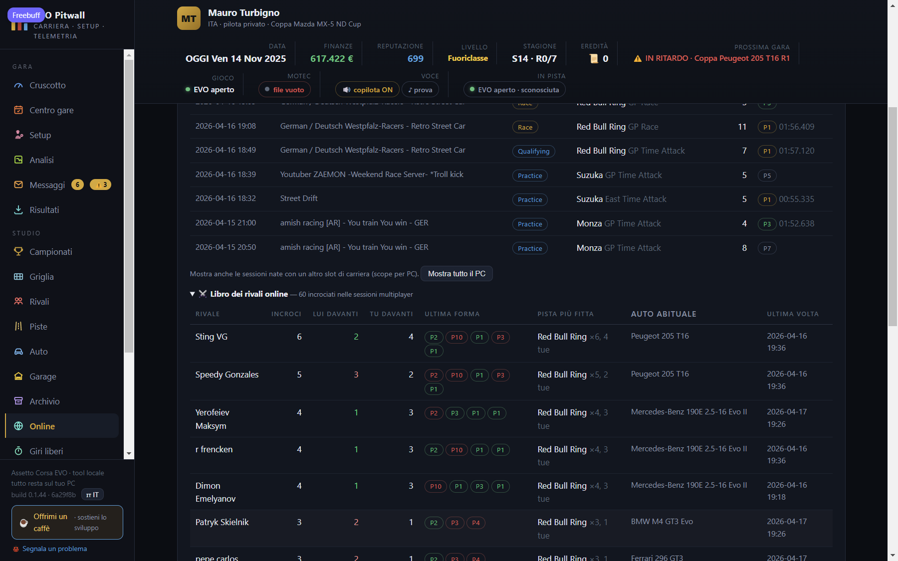
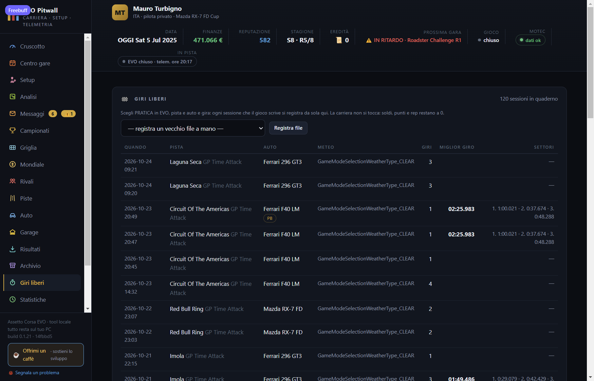

# EVO Pitwall

**Una carriera persistente e locale per Assetto Corsa EVO.**


[Release](https://github.com/turbignox-hash/ac-evo-career/releases) · [English](README.md) · [Guida amico](GUIDA-AMICO.md) · [Issue](https://github.com/turbignox-hash/ac-evo-career/issues/new) · [Ko-fi](https://ko-fi.com/turbigno)

> **Progetto indipendente.** EVO Pitwall non è una mod di contenuti, non è affiliato a KUNOS e non include codice, dati, testi o grafica di altre app di carriera. Gira sul tuo PC, legge i file che Assetto Corsa EVO scrive e tiene la carriera in un salvataggio locale.

## Cos'è

EVO Pitwall aggiunge uno strato di carriera *attorno* ad Assetto Corsa EVO: una scala di **86 serie, 6 discipline e 7 livelli**, contratti, iscrizioni, premi, sponsor, piloti rivali, classifiche, griglie, consigli sull'assetto dalla telemetria e una radio copilota. È una web app locale (e una CLI) che prepara il weekend di gara, apre il gioco e legge il risultato nativo a fine gara.

Il gioco resta il gioco. EVO Pitwall non sostituisce la carriera nativa di AC EVO, non modifica i suoi contenuti e non richiede account, cloud o altre applicazioni di carriera.

**Ramo main:** build **0.1.55** · **911/911** test · **370** file lint, 0 warning.

## Installazione

### Opzione A — pacchetto amico pubblicato

La release pubblicata è **[v0.1.55](https://github.com/turbignox-hash/ac-evo-career/releases/tag/v0.1.55)**. L'asset è lo ZIP del pacchetto amico: `installa.cmd`, le guide e tutto il codice. Si installa senza privilegi di amministratore e scarica Node.js portatile se manca.

> Il pacchetto v0.1.55 è precedente agli ultimi commit su installer e pulizia dei report. Il ramo `main` è più recente.

### Opzione B — EXE Windows dal ramo `main`

Da un checkout del sorgente:

```bash
npm run installer          # online: scarica Node e codice quando serve
npm run installer:offline  # offline: include Node portatile e il codice (~40 MB)
```

Produce `dist\EVO-Pitwall-Setup.exe` oppure `dist\EVO-Pitwall-Setup-Offline.exe`:

- scelta grafica della cartella, log e pulsante **Disinstalla**;
- nessun privilegio di amministratore, Git non richiesto;
- `--silent --dir <percorso>` per l'installazione senza interfaccia;
- l'EXE offline funziona senza connessione; quello online richiede internet.

> **Stato installer:** il builder EXE è in `main`, ma gli EXE **non sono ancora allegati alla release v0.1.55**. Si possono costruire in locale o attendere la prossima release.

<details>
<summary>Firma Authenticode opzionale</summary>

Imposta `EVO_SIGN_PFX` + `EVO_SIGN_PASSWORD`, oppure `EVO_SIGN_THUMBPRINT` per un certificato già installato in Windows. Il builder trova `signtool.exe` nel Windows SDK (o usa `EVO_SIGNTOOL`), firma con SHA-256 e timestamp, poi scrive il `.sha256` del file firmato. `npm run verifica-firma` esegue gli stessi controlli a mano.

Un **certificato self-signed non toglie SmartScreen**: aiuta solo su un PC che si fida di quella CA. Per togliere «Autore sconosciuto» serve un certificato **OV o EV emesso a un'identità verificata**. La firma da sola non garantisce la scomparsa dell'avviso: SmartScreen pesa anche l'hash e la reputazione del download.

</details>

### Primo avvio

1. Installa e avvia **Assetto Corsa EVO** almeno una volta, così crea le sue cartelle dati.
2. Esegui l'installer, oppure estrai lo ZIP amico e lancia `installa.cmd`.
3. La GUI apre il modulo d'iscrizione; `setup` trova da solo i percorsi del gioco.
4. Le app in gioco **Cruscotto** e **Pitwall** richiedono l'opzionale [ACE UI App Loader](https://github.com/dreasgrech/ACEUIAppLoader). Senza quella mod il resto funziona lo stesso, e l'installer lo dice.

Guida completa: [GUIDA-AMICO.md](GUIDA-AMICO.md), con la sezione inglese in fondo; versione inglese intera in [FRIEND-GUIDE-EN.md](FRIEND-GUIDE-EN.md).

## Novità della 0.1.55

- **Installer Windows senza amministratore.** Un EXE WinForms avvolge le stesse regole di installazione, con scelta cartella, log e disinstallatore; varianti online e offline.
- **Avviso loader.** Se manca ACE UI App Loader, le app in gioco vengono saltate con un messaggio chiaro invece di un guasto silenzioso.
- **Sicurezza release.** Il tool si ferma su albero sporco, corpo mancante o vuoto, tag non su `HEAD` o assente dal remoto e upload di un asset fallito. Il pacchetto amico nasce solo da un albero completamente pulito.
- **Preflight di firma opzionale.** Con le variabili di firma attive verifica catena Authenticode, sidecar `.sha256` e metadati di build prima di allegare qualcosa.
- **Codice indipendente.** Rimossi il ponte ai journal esterni, il canale e le regole derivate. Calendario, garage e dizionario leggono solo file scritti dal gioco. Una guardia scansiona il progetto e fallisce se ricompare un riferimento al prodotto esterno.
- **Controlli attuali:** `npm test` **911/911**, `npm run lint` **370 file, 0 warning**.

Le note dell'ultima release pubblicata (v0.1.55) descrivono il taglio di indipendenza; installer e sicurezza release sono commit successivi sul ramo `main`.

## In evidenza

- **Una carriera, non un generatore di gare.** 86 serie, 6 discipline, 7 livelli, 18 piste; gate per posizione, sedili aperti/chiusi, economia per serie, sistemi punti reali, gare iconiche, contratti, sponsor e duello di stagione.
- **Weekend preparato in automatico.** La scheda gara conosce pista, giri, ora, meteo, griglia e auto. «Prepara tutto» scrive il weekend; tu guidi. L'auto viene impostata dal tool quando l'ha imparata; un'auto sconosciuta richiede una scelta a mano in EVO, poi entra nel dizionario.
- **Bilanciamento multiclasse progressivo.** Zavorre (kg) e penalità (%) calcolate dai risultati veri, con confidenza per pista e tetti. La tab Griglia mostra la convergenza; il sistema non inventa dati quando la prova manca.
- **Un meccanico che legge la telemetria.** Pressioni con la regola dei 4 PSI, camber, altezza da terra, bumpstop, ripartizione freni, TC e benzina per giro, dai file `.ld` di EVO quando ci sono, con un fallback dichiarato quando non ci sono.
- **Radio copilota, non chatbot.** Un solo nucleo narratore per pagina e server: bandiere, benzina, gomme, gap, finestra box, ultimo giro e bandiera a scacchi, con quattro livelli (`off`, `essenziale`, `normale`, `full`).
- **19 tab.** Cruscotto, Centro gare, Setup, Messaggi, Campionati, Griglia, Rivali, Analisi, Piste, Auto, Garage, Risultati, Archivio, Online, Giri liberi, Statistiche, Finanze, Difficoltà, Impostazioni. Le gare online restano in archivio senza punti carriera; Giri liberi è una modalità prova separata.
- **Bilingue e locale.** Interfaccia italiana/inglese, CLI con `EVO_LANG`; server locale su `127.0.0.1:8642`. Nessun account, nessun upload, nessun cloud.

## Schermate

| Cruscotto | Centro gare |
| --- | --- |
|  |  |
| **Setup e telemetria** | **Griglia e bilanciamento** |
|  |  |
| **Archivio online** | **Giri liberi** |
|  |  |

Schermate live da una carriera reale, interfaccia in inglese. L'elenco completo dei tab è qui sopra; la GUI è tutta cliccabile (nomi auto, piloti, piste, serie e cifre dell'intestazione aprono la scheda giusta).

## Il weekend di gara

```text
node ac-evo-career.mjs next      # cosa c'è dopo e la scheda esatta del weekend
node ac-evo-career.mjs race      # paga l'iscrizione, segna il round, apre EVO
   ... guida ...
node ac-evo-career.mjs import    # legge il risultato nativo e aggiorna la carriera
```

Nella GUI, **Prepara tutto** fa la preparazione e il watcher importa il risultato da solo a fine gara. L'auto viene preparata dal tool; se EVO non la conosce ancora, sceglila una volta — il tool la impara dal garage e dal menu del gioco.

Il risultato viene letto dal file nativo `Results\*.sessionresults.json`. Non c'è iniezione di file né avvio di sessione da riga di comando: EVO non lo espone, quindi l'app apre il gioco e prepara il weekend che il gioco già scrive.

## Privacy e sicurezza del save

- **Tutto locale.** Nessun account, nessun upload di telemetria, nessun servizio di carriera remoto. Il server GUI ascolta su `127.0.0.1:8642` e rifiuta origini esterne.
- **Il save è tuo.** La carriera vive in `data/`; aggiornamenti e installazioni amico non la toccano. Il backup automatico tiene una rotazione di ZIP del solo save in `data/salva-save/`, con soglia di 36 ore.
- **Nessuna patch al processo di gioco.** Il tool legge i file che il gioco scrive e prepara i file del weekend che il gioco usa; non inietta codice in `AssettoCorsaEVO.exe`.
- **Immagini.** Le immagini ufficiali di auto e piste restano di KUNOS e non sono ridistribuibili; vedi [LICENSE.md](LICENSE.md).

## Limiti, detti chiaramente

- EVO non accetta un avvio sessione da riga di comando. La gara si prepara dal weekend del gioco; l'app non può aggirarlo.
- L'auto è automatica solo dopo che il tool l'ha imparata; un'auto mai vista può richiedere una scelta a mano.
- Le transizioni asciutto↔bagnato dentro una sessione non sono implementate dal gioco; i round usano preset meteo fissi (ora pianificati per sessione).
- Nessun overlay o pannello VR. I widget opzionali richiedono ACE UI App Loader.
- Gli EXE sono non firmati per default; aspettati SmartScreen e leggi la nota sulla firma.
- La carriera nativa di EVO resta intatta; questa è una progressione parallela.
- Il catalogo contenuti è osservato dal gioco, non certificato; il formato del save è versionato.

## Sviluppo

Serve **Node.js 18+**. L'app non ha dipendenze a runtime; la toolchain di test/lint usa Biome e Playwright Core.

```bash
npm install
npm test
npm run lint
npm run check
```

Costruzione installer:

```bash
npm run installer
npm run installer:offline
```

La suite gira interamente in sandbox e non tocca mai i file reali del gioco. Il progetto è ESM puro: `src/` (carriera, risultati, web UI, telemetria), `gui/` (interfaccia browser), `uiapp/` (widget in gioco), `config/` (la scala), `test/` e `tools/` (installer, release, calibrazione e manutenzione).

Il tooling di release è in `tools/crea-release.mjs`, `tools/pacchetto-amico.mjs` e `tools/release-assets.mjs`; la checklist è [RELEASE_CHECKLIST.md](RELEASE_CHECKLIST.md).

## Licenza

**© 2026 Mauro Turbigno — tutti i diritti riservati.** Opera privata: nessuna ridistribuzione, pubblicazione, rivendita o incorporazione in altri prodotti senza consenso scritto. Assetto Corsa EVO è un prodotto KUNOS Simulazioni; questo progetto non è affiliato né approvato da KUNOS. Testo completo in [LICENSE.md](LICENSE.md).

## Link

- [Issue e idee](https://github.com/turbignox-hash/ac-evo-career/issues/new)
- [Release](https://github.com/turbignox-hash/ac-evo-career/releases)
- [Changelog](CHANGELOG.md)
- [README inglese](README.md)
- [Guida amico — italiano](GUIDA-AMICO.md) · [Guida amico — inglese](FRIEND-GUIDE-EN.md)
- [Ko-fi](https://ko-fi.com/turbigno)
