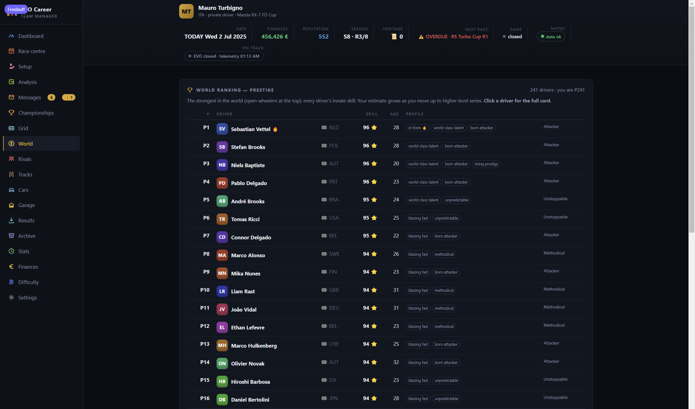

# EVO Pitwall (`ac-evo-career`) — carriera automatizzata per Assetto Corsa EVO

🐞 **Bug o idea?** [Apri una issue su GitHub](https://github.com/turbignox-hash/ac-evo-career/issues/new) — oppure usa il link “Segnala un problema” nella barra laterale del tool: ti apre la stessa pagina *già compilata* con versione build, serie in corso, errori recenti e difficoltà. · ☕ **Sostieni il progetto:** [Ko-fi](https://ko-fi.com/NOME-UTENTE) ·

Una carriera persistente automatizzata per **Assetto Corsa EVO**, ispirata a un'app
di carriera per Automobilista 2.

Il modello d'origine non è un mod di contenuti: è un'applicazione che sta *fuori*
dal gioco. Decide la gara, avvia il simulatore, poi rilegge i risultati e aggiorna
soldi, reputazione, classifica e mercato. Per EVO si fa la stessa cosa, con una
differenza importante e detta subito:

> **EVO non accetta argomenti da riga di comando e non legge un file di sessione
> scritto da fuori.** Non esiste l'equivalente di `race.ini` di Assetto Corsa 1.
> Quindi la gara si prepara nella sua interfaccia: l'app ti dice *esattamente* cosa
> impostare (una schermata, due click) e apre il gioco per te. **Tutto il resto è
> automatico**: il risultato lo legge dai file nativi del gioco.
>
> **L'unico intervento che resta in carico a te è selezionare l'auto a mano:** al
> momento non è possibile impostarla in automatico, quindi la scegli tu
> nell'interfaccia del gioco — e sulla scheda gara trovi già indicato quale.

**La carriera è ispirata ad Apex to Zero, l'app di carriera per Automobilista 2,
ma è sviluppata da zero**: ladder, economia, punti, profili, classi e serie sono
codice e dati scritti per EVO, non ricostruzioni del progetto d'origine.

## I quattro appunti da sapere in partenza

1. **L'auto si sceglie a mano, per ora.** Lancio della sessione, calendario,
   iscrizioni, slider AI, import dei risultati e tutto quanto a valle è
   automatico; resta manuale solo la scelta dell'auto (la scheda gara dice qual'è).
2. **Il sistema di bilanciamento progressivo impara mentre giri.** I campionati
   multiclasse che insieme girano auto **della stessa categoria** ricevono
   **zavorre (kg) e penalità (%)** calcolate dal tool. Ogni risultato reale viene
   registrato in log append-only (`data/grid-calibrazione.json`): più si gira e
   più il sistema apprende quanto ogni auto dista davvero dalla base e
   ricalibra i pesi — con confidenza per traccia e tetto mai superato: non
   inventa numeri dal nulla. L'andamento si vede nella tab **Griglia**.
3. **Il Meccanico calcola tutte le migliorie attualmente possibili** — pressioni
   con la regola dei 4 PSI, camber, altezza da terra, bumpstop, ripartizione,
   TC, benzina per giro — e ti dice se, e quale, dato non è disponibile (file
   di telemetria vuoti ecc.): preferisce la telemetria vera dei `.ld` di EVO,
   altrimenti stima; **non tocca mai il save finché non premi Applica**.
4. **Gare con tempo dinamico (asciutto→bagnato e viceversa) non si possono
   fare: il gioco non lo ha ancora implementato.** Assetto Corsa EVO al momento
   non supporta transizioni mettiche dinamiche *dentro la sessione*, quindi
   l'app programma solo preset meteo fissi per round. Quando Kunos la aggiungerà,
   i file da toccare sono `src/weather.mjs` e i profili dei round.

## Schermate (tutte le 19 tab della GUI reale)

Interfaccia in inglese nei catturi; la lingua si sceglie in Impostazioni
(Italiano / English). La stessa documentazione in inglese è nel [README.md](README.md).

| Tab | Cosa ti dà |
| --- | --- |
|  | **Cruscotto** — statistiche di stagione (vittorie, podi, punti, grafico round), scheda gara con la sessione esatta da impostare in EVO, countdown alla prossima gara. |
|  | **Centro gare** — fascia calendario della stagione, round ancora da correre, checklist della prossima gara. |
|  | **Setup** — i consigli del Meccanico (pressioni → regola dei 4 PSI, camber, altezza, bumpstop, freni, TC, benzina), il grafico giri con telemetria MoTeC, lo storico degli assetti e la diagnostica telemetria per auto. |
|  | **Messaggi** — la posta dell'agente: offerte, sfide, gare urgenti. |
|  | **Campionati** — le tue serie, gate di stagione e progressi. |
|  | **Griglia** — il bilanciamento progressivo: zavorre kg e penalità % per auto, proposte per traccia, fascia AI, calibrazione appresa. |
|  | **Mondiale** — la classifica di tutti i piloti del mondo. |
|  | **Rivali** — testa a testa, forma, classificazioni di rivale e nemesi. |
|  | **Analisi** — autopsie giri, dossier rivali, i cinque strumenti del pilota. |
|  | **Piste** — il Libro delle piste: storia, soprannomi, maestria, best personali. |
|  | **Auto** — il Libro delle auto con render ufficiali e indice di prestazione. |
|  | **Garage** — auto possedute o vinte, stime e vendite. |
|  | **Risultati** — import con un click dell'ultima gara compatibile (o inserimento a mano). |
|  | **Archivio** — ogni sessione scritta da EVO, ricercabile, con classifiche complete. |
| (screenshot in arrivo) | **Giri liberi** — la modalità pura della giornata di test: scegli PRATICA, pista e auto in EVO e gira; ogni sessione che il gioco scrive si registra da sola nel quaderno, con il libro PB per auto × pista e il giro ideale sommato dai migliori settoriali di sempre. La carriera non si tocca. |
|  | **Statistiche** — stanza dei trofei, sigilli, grafici di punti e posizione. |
|  | **Finanze** — il registro dei flussi: premi, sponsor, iscrizioni. |
|  | **Difficoltà** — bande AI per serie, trim adattivo, tutto va negli slider del gioco. |
|  | **Impostazioni** — slot carriera, lingua, controlli d'installazione. |

## Versione della build visibile e aggiornamenti

- Il piè della barra laterale di ogni schermata mostra la **versione della
  build**: `build 0.1.2 · 809ea00` (semver del package.json + hash breve del
  commit). Cambia a ogni salvataggio del progetto: `sincronizza-git.cmd` la fa
  salire da sola (tools/bump-versione.mjs) prima del commit, così due build non
  si confondono mai. `node tools/bump-versione.mjs --check` stampa il numero
  attuale.
- La **banda aggiornamenti** a ogni avvio della GUI confronta il remote GitHub
  `offsite` col disco: GitHub in avanti → banda gialla con "Aggiorna ora"
  (git fetch + merge --ff-only + `npm test`, consenso sempre richiesto, il save
  in `data/` non si tocca mai); al passo o offline → zitta. Da terminale:
  `node tools/aggiornamenti.mjs` (domanda `s/N`, Invio/15 s = no).

### Zip o clone? I modi di installarlo su un altro PC

| | **Un solo file, `installa.cmd`** (dal 26/10 il modo di default) | **Clone git** (per sviluppatori) |
| --- | --- | --- |
| Serve | niente (Node lo scarica da solo, in forma portatile) | Node 18+ e Git |
| Installi una volta | doppio click: chiede la cartella e il token di lettura su repo privato, poi da solo | `git clone …` + `git remote rename origin offsite` |
| Aggiornamenti | **automatici**: `build-id.txt` scritto dall'installer e updater via API GitHub ogni avvio | **automatici**: ogni avvio di `avvia.cmd` (o bottone GUI) propone fetch+merge, Invio/15 s = no |
| il save (`data/`) | mai toccato: nasce vergine sul PC dell'amico e gli aggiornamenti lo escludono | mai toccato dagli aggiornamenti (è fuori dal repo) |
| File rimossi dal progetto sul tuo disco | restano sul disco innocui (la copia non cancella) | spariti (merge vero) |
| Avvertenza | il token serve UNA volta ed è valido per tutti i PC | il repo privato chiede le credenziali GitHub la prima volta |

Detto breve: **l'amico → un solo file `installa.cmd`**; **sviluppatore sincero → clone**.

(Vie storiche, ancora valide: il **pacchetto-amico zip** di `tools/pacchetto-amico.mjs`
e il **Download ZIP dal sito** — entrambi si auto-regolano al primo avvio.)

## Novità delle build recenti

Salienti della fascia **0.1.13–0.1.18** — ogni salvataggio scrive anche la sua
scheda leggibile in [report/](report/), con dentro l'esito vero della suite di
test:

- **Il copilota parla la tua lingua — e ha senso.** Segue la lingua
dell'interfaccia (UI inglese → voce inglese), non ripete mai la stessa frase
entro 12 s, parla solo quando il *valore* cambia davvero, e resta muta i primi
secondi dopo un cambio di sessione: i dati stanti della sessione prima sono
quelli che una volta gli facevano dire «sto finendo il giro 1» mentre eri
ancora in uscita dai box.
- **Le griglie si costruiscono da sole per tutte le serie.** Il sistema
  «armonico» delle varianti (una livrea diversa per ogni cella — EVO crasha
  con gli schemi con celle ripetute) vale per **tutte le auto** della serie,
  non per una scelta a mano. I template di serie finiscono nel magazzino del
  save (`data/grid-templates/`), quelli di fabbrica coprono i buchi, e su un
  PC vergine non serve più il rituale manuale «N livree + APPLICA». Il
  progresso del bilanciamento si segue nella tab **Griglia**.
- **Giri liberi — la modalità della giornata di prove.** In EVO scegli
  PRATICA, pista e auto qualunque e giri: ogni sessione che il gioco scrive
  si registra da sola nel quaderno, con il libro PB per auto × pista, i delta
  per settore contro i tuoi migliori di sempre, il giro ideale sommato dai
  settori e l'analisi telemetrica. La carriera non si tocca.
- **Installazione un-file per l'amico.** `installa.cmd` (un file solo, pochi
  KB) installa tutto su un PC Windows — Node portatile scaricato se manca,
  codice da GitHub,  `build-id.txt` scritto, test passati, scorciatoia sul
  desktop con l'icona del programma e wizard di prima apertura.
  `disinstalla.cmd` rimuove tutto in pulizia e rifiuta le cartelle che non
  somigliano a un'installazione. Entrambi coperti da test in sandbox.
- **I vecchi messaggi si leggono comunque.** Le note di paddock e di
  calibrazione griglia scritte quando la carriera era in italiano si
  traducono in visualizzazione nell'interfaccia inglese — il save non viene
  comunque mai toccato.

## Installazione

Per un'installazione su altro PC (clone dal repo, primo setup, aggiornamenti,
problemi tipici) c'è la guida: [GUIDA-AMICO.md](GUIDA-AMICO.md).

Serve solo **Node.js 18 o superiore**. Nessuna dipendenza da installare.
Assetto Corsa EVO installato e avviato almeno una volta (perché crei le sue
cartelle dati).

```bash
node ac-evo-career.mjs setup
```

`setup` trova da solo:

| Cosa | Dove viene cercato |
| --- | --- |
| cartelle dati | `%USERPROFILE%\Saved Games\ACE` (dalla 0.5) e `%USERPROFILE%\Documents\ACE` (versioni precedenti) |
| risultati | `<cartelle dati>\Results\*.sessionresults.json` |
| log | `<cartelle dati>\Logs` |
| eseguibile | `AssettoCorsaEVO.exe` in tutte le librerie Steam (`libraryfolders.vdf`) |

Percorsi diversi? Si forzano una volta sola:

```bash
node ac-evo-career.mjs setup --data "D:\Dati\ACE" --game "D:\Steam\steamapps\common\Assetto Corsa EVO\AssettoCorsaEVO.exe"
```

Verifica che la scala carriera citi contenuto che **hai davvero**:

```bash
node ac-evo-career.mjs content --validate   # problemi + i tre ID più simili per ognuno
node ac-evo-career.mjs content --list       # tutto il contenuto visto nell'installazione
node ac-evo-career.mjs content --search gt3
```

### Cominciare

```bash
node ac-evo-career.mjs new --name "Il Tuo Nome" --nation ITA
node ac-evo-career.mjs status
```

Si può cominciare anche dall'interfaccia grafica: apre sul modulo d'iscrizione
dove scrivi il nome pilota (uguale a quello usato in EVO) e la nazione.

Si entra da una serie di livello 1 con 6.000 in tasca. La disciplina d'ingresso
si sceglie con `--discipline entry|touring|single|gt|endurance|strada`, altrimenti
si comincia da Coppa Città.

```bash
node ac-evo-career.mjs series --discipline gt    # la scala: cosa è aperto, cosa manca
node ac-evo-career.mjs enter gt4_open            # cambia serie pagando affitto o acquisto
node ac-evo-career.mjs enter gt4_open --buy      # la compri invece di affittarla
```

**Nome pilota:** il nome dato a `new` serve anche a riconoscerti nei risultati
del gioco. Se in EVO ti chiami diversamente, usa quello **del gioco**
(`new --name "Mauro Turbigno"`, oppure `rinomina --name "Mauro Turbigno"`).
L'import cerca prima la bandierina del gioco, poi il nome, poi l'unico pilota
senza pallino `•` (gli AI di EVO lo hanno). Il nome che EVO usa per te sta in
`Logs\log-*.txt` alla riga `Creating Car (Nome Cognome ...)`.

**La tua prima gara, dall'inizio alla fine, in cinque passi:**

1. `next` — leggi la scheda gara: pista, giri, meteo, e l'auto.
2. `race` — quota pagata, gara marcata, EVO si apre da solo.
3. Nel gioco, compila i campi della scheda gara e **scegli l'auto a mano** — è
   tutta la parte manuale.
4. ... vai in pista ...
5. `import` — oppure lascialo fare al watcher della GUI: soldi, classifica,
   rivali, migliorie e consigli del meccanico si aggiornano da soli.

## La carriera: come è fatta

**79 serie, 6 discipline, 7 livelli, 4 tier** — un albero che si attraversa con
le offerte di sedile.

| Tier | Livelli | Cosa si guida |
| --- | --- | --- |
| Rookie | 1–2 | compatte, monomarca, MX-5, GT86 |
| Semi-pro | 3–4 | storiche turbo, turismo, GT4, gruppo B |
| Pro | 5–6 | GT3, GT2, turismo pro, Formula 2004, endurance |
| Elite | 7 | Formula Elite (SF-25), GT Elite, Endurance Elite, Strada Elite |

Le sei discipline sono **Entry Level, Turismo, Monoposto, Gran Turismo,
Endurance, Strada e Rally**.

- **Gate per posizione.** Ogni serie chiede un piazzamento nei primi *N* in una
  serie inferiore (es. `top: 5`); senza quel risultato il sedile non è
  disponibile, e `series` ti dice cosa manca.
- **Accesso aperto o chiuso.** Le serie `open` si comprano o si affittano; le
  `closed` (Formula, GT, Endurance e Strada Elite) sono parco chiuso:
  servono reputazione e un contratto.
- **Economia per serie.** Modelli `pocket`, `sponsor`, `factory`, `heritage` con
  prezzo d'acquisto, affitto, iscrizione, premio per posizione, bonus titolo e
  premio maggiorato (×1,5) nelle **prove iconiche** (Sebring 12h, Bathurst 12h).
- **Sistemi punti reali.** `club`, `one_make`, `f1_2003`, `f1_modern`, `sro_gtwc`,
  `wec`, `historic_endurance`.
- **Calendario con formato.** Ogni round ha ora del giorno, giri e preset meteo;
  il profilo della serie decide prove, qualifiche, partenza e pit obbligatorio.
- **Mondo vivo.** 240 piloti AI con skill, aggressione, costanza, archetipo di
  carattere, età, ritiri, forma calda e fila dei leggendari.
- **Difficoltà a strati.** `totale = base + trim + offClass + offTrack`, clamp
  70–120 e conversione nello slider AI del gioco; il trim adattivo si adegua a te
  e le anomalie restano in attesa di accettazione o rifiuto.
- **Bilanciamento multiclasse progressivo.** I campionati della stessa categoria
  che girano insieme guadagnano **zavorre kg e penalità %** che convergono con i
  risultati reali — la calibrazione appresa descritta sopra.
- **Sponsor, contratti, sfide, sigilli.** Sponsor a soglie di reputazione,
  obiettivi contrattuali di stagione, mini-sfide per round, sigilli personali:
  tutto nel registro flussi e nella stanza dei trofei.
- **Duello della stagione e nemesi.** Il tool elegge il rivale della
  classifica; due scontri persi di fila lo fanno nemesi, batterlo chiude la
  faida (e vale un trofeo).
- **Registro flussi.** Ogni premio, sponsor, iscrizione e bonus è scritto in
  `data/flows.jsonl`; il revisore ricostruisce cassa e reputazione da lì.
- **Journal.** La rassegna di fine stagione si esporta in
  `data/journal/stagione-N.md`.

## Programmazione: giorno e meteo per round

Il pianificatore (tab **Centro gare**, CLI `piano`) dice quando firmare, noleggiare
e correre ogni round senza perdere gare, con ora del giorno e preset meteo per
round. **Solo preset fissi:** dato che EVO non può ancora passare da asciutto a
bagnato in corsa (appunto 4 sopra), ogni round ha un meteo bersaglio e la scheda
gara riporta il nome esatto da scegliere in gioco.

## Perché la gara non si può lanciare via file

Verificato sull'installazione reale, non per sentito dire:

- `AssettoCorsaEVO.exe` **non accetta argomenti** che carichino una sessione o
  una stagione.
- La definizione della sessione è **protobuf binario**:
  `last_season.seasondefinition` e `GameModes\GameModeType_*.gamemodesave`. Il
  gemello `.json` è una copia leggibile scritta dal gioco, non un ingresso
  documentato.
- **Il formato dei risultati invece è JSON semplice e affidabile**:
  `Results\<aaaammgg-hhmmss>_SP_<Sessione>.sessionresults.json` con classifica,
  giri, miglior giro, distacchi, soste e penalità. È quello che l'app legge
  (posizioni 0-based: il vincitore è 0; l'import lo rileva da solo).

Quindi il compromesso: **una schermata da applicare in gioco (la scheda gara),
tutto il resto automatico.** Se Kunos esporrà un ingresso vero, l'unico pezzo da
sostituire è `src/race.mjs`.

## Comandi

| Comando | Cosa fa |
| --- | --- |
| `setup [--data <percorso>] [--game <exe>]` | rileva e salva i percorsi dell'installazione |
| `content [--validate\|--list\|--search <testo>]` | contenuto visto nell'installazione e verifica della scala |
| `new --name "Nome" [--nation ITA] [--discipline gt] [--force]` | comincia una carriera |
| `rinomina --name "Nome Cognome"` | cambia il nome pilota (deve combaciare con quello in EVO) |
| `status` | cruscotto: soldi, reputazione, sedile, tier, posizione |
| `series [--discipline gt] [--all]` | la scala completa, con gate e serie bloccate |
| `enter <nodeId> [--buy] [--force]` | cambia serie pagando affitto o acquisto |
| `calendar` | calendario della stagione, con ora e meteo di ogni round |
| `standings` | classifica della serie |
| `paddock [--all]` | piloti rivali: archetipo, età, banda di difficoltà |
| `messages` | messaggi dell'agente e notizie dal paddock |
| `next [--car <id>]` | la prossima gara con la scheda da impostare nel gioco |
| `race [--car <id>] [--dry-run] [--no-launch] [--force-launch]` | paga l'iscrizione, segna la gara attesa, apre EVO |
| `import` | legge il risultato nativo e aggiorna la carriera |
| `import --position N --cars M [--dnf] [--fl]` | inserimento manuale se il file non basta |
| `import --inspect [--full]` / `--ledger` | ispezione dei file risultato / registro degli import |
| `import --allow-any` / `--force` | cerca fra tutte le gare / forza un re-import (se sai perché) |
| `difficulty [--mode adaptive\|fixed\|custom] [--value N]` | come si calcola l'AI |
| `difficulty --lock <node>` / `--unlock <node>` | blocca la difficoltà di una serie |
| `difficulty --accept` / `--reject` | risponde a un suggerimento in attesa |
| `griglia-calib [--convalida]` | la calibrazione del bilanciamento: riepilogo e confidenza per traccia |
| `season-end [--force]` | chiude l'anno, paga il titolo e apre il mercato |
| `review [--season N]` | la rassegna della stagione: gare, rivali, duelli, premi |
| `dottore [--fix]` | verifica dell'integrità della carriera (e correzione) |
| `accept <n>` | accetta un'offerta di sedile |

Lingua da CLI: `set EVO_LANG=en` (CMD) / `export EVO_LANG=en` (Bash) — inglese
ovunque, senza toccare il save.

## Personalizzare la scala

Tutto in `config/career.evo.ladder.json`: discipline, livelli, gate, economia,
sistemi punti, profili di sessione, pool dei nomi e le 79 serie. Auto e piste si
citano con l'ID della cartella dentro `content\cars` e `content\tracks`
(es. `ks_ferrari_296_gt3`, `imola`).

```json
{
  "nodeId": "gt3_serie_a",
  "display": "GT3 Serie A",
  "discipline": "gt",
  "level": 5,
  "access": "open",
  "requires": { "nodeId": "gt3_coppa", "top": 5 },
  "points": "sro_gtwc",
  "profile": "feature",
  "gridSize": 20,
  "ai": [90, 101],
  "econ": { "buy": 550000, "rent": 55000, "entry": 8000, "prize": 65000, "champion": 190000, "model": "sponsor", "icon": "" },
  "cars": ["ks_ferrari_296_gt3", "ks_bmw_m4_gt3"],
  "calendar": [{ "track": "imola", "name": "Imola - Apertura", "laps": 11, "hour": 13, "weather": 0 }]
}
```

`ai` è la banda della griglia (il più forte in alto) — media della serie al
centro della banda, più trim adattivo e offset; la conversione nello slider del
gioco sta in `aiSlider`.

**Con contenuto moddato**: il catalogo è ricostruito dai file che il gioco scrive;
i mod installati dopo l'ultimo avvio potrebbero non comparire in `content --list`.
Scrivi comunque il loro ID nel ladder: `content --validate` ti dirà solo che non
li ha ancora visti. Il mod si installa come sempre (`.kspkg` in
`Saved Games\ACE\mods`).

## Provare tutto senza avere il gioco installato

```bash
node tools/evo-demo.mjs                     # installazione finta con il contenuto della scala
ACE_DATA="demo/ace" node ac-evo-career.mjs content --validate
ACE_DATA="demo/ace" node ac-evo-career.mjs new --name "Mauro Sgamer" --nation ITA
ACE_DATA="demo/ace" node ac-evo-career.mjs race --no-launch
ACE_DATA="demo/ace" node tools/evo-fake-result.mjs --position 3 --cars 12 --track Imola --fl
ACE_DATA="demo/ace" node ac-evo-career.mjs import
```

`tools/evo-fake-result.mjs` scrive un risultato **nel formato reale** (posizioni
0-based, pallino `•` sugli AI, `total_time` vuoto per il ritiro) con le modalità
`--position N --cars M`, `--fl` e `--dnf`. `ACE_DATA` è un override esclusivo: con
quello impostato l'app guarda **solo** quella cartella.

## File del progetto

Il server della GUI è `src/webui.mjs` (API JSON + pagina in `gui/index.html`):
stesse viste della CLI, stesso file di salvataggio `data/evo-career.save.json`.

```
ac-evo-career.mjs                      entry point
config/career.evo.ladder.json         la scala: discipline, livelli, gate, economia, punti, serie
src/paths.mjs                          cartelle dati, eseguibile, lancio del gioco
src/content.mjs                        catalogo contenuto, verifica ID, suggerimenti
src/world.mjs                          piloti rivali, banda di serie, simulazione, evoluzione
src/state.mjs                          salvataggio, gate, classifica, economia, difficoltà
src/results.mjs                        lettura dei file di risultato nativi
src/import.mjs                         import unico (GUI+CLI+watcher): anti-doppioni, backup, log
src/race.mjs                           scheda gara, iscrizione, gara attesa, lancio
src/motec.mjs / src/lapdelta.mjs       telemetria (.ld), confronti fra giri
src/grid-calib.mjs / grid-apply.mjs    bilanciamento progressivo: registro calibrazione e scritture
src/webui.mjs + gui/                   l'interfaccia grafica (server locale, 127.0.0.1:8642)
tools/bump-versione.mjs                bump della versione build (chiamato da sincronizza-git.cmd)
tools/aggiornamenti.mjs                controllo aggiornamenti GitHub + installazione
tools/evo-demo.mjs / evo-fake-result.mjs  installazione finta e risultati finti per i test
data/evo-career.save.json              la tua carriera (un file, da copiare o condividere)
data/grid-calibrazione.json            registro append-only della calibrazione dai risultati reali
data/results-archive/                  copia dei risultati grezzi di ogni gara importata
```

## FAQ e problemi frequenti

**L'import dice "risultato non letto / posizioni sbagliate".** Controlla che il
file sia uno nativo (`Results\*.sessionresults.json`, non una copia risalvata)
e che il nome del pilota combaci con `Logs\log-*.txt` (`Creating Car (Nome…)`).
EVO scrive le posizioni da 0 e l'import lo gestisce, ma un file modificato a
mano rompe il formato: in quel caso entra la gara a mano con
`import --position N --cars M`.

**Il Meccanico dice che manca una fonte.** Vuol dire che per quell'auto non c'è
ancora telemetria `.ld` usabile (o il file è vuoto): fai un giro netto in gioco
e alla prossima analisi i consigli nascono su dati veri. Spiega sempre quale
fonte manca e su quale stima ripiega.

**Due auto della stessa classe si contendono la gara a fatica.** Le griglie di
stessa categoria prendono zavorre e penalità dalla calibrazione, non a stima:
hanno bisogno prima di un po' di gare vere, poi ricalibrano con confidenza per
pista. La convergenza si segue nel tab **Griglia** (`griglia-calib` è la versione
da terminale).

**La GUI mostra "cerca su disco" invece di leggere una cartella.** È voluto:
i dialoghi del browser non restituiscono i percorsi scelti, quindi il cercatore
sfoglia le unità del PC. Arriva fino alla cartella Risultati e conferma lì.

**Ho aggiornato il gioco / spostato la libreria Steam.** Rilancia
`node ac-evo-career.mjs setup` (oppure correggi i percorsi vivi in
Impostazioni, senza riavviare) e passa `content --validate` per verificare che
la scala combaci ancora.

## Limiti, detti chiaramente

- **La gara non si può lanciare via file.** EVO ignora gli argomenti da riga di
  comando e legge le sessioni solo dalla sua interfaccia. L'app dà la schermata
  esatta e apre il gioco; **l'auto si sceglie a mano** (appunto 1).
- **La difficoltà AI si imposta in gioco.** L'app la calcola e la adatta per
  serie, ma lo slider lo muovi tu; i suggerimenti adattivi aspettano
  accettazione o rifiuto.
- **Niente pannello dentro il gioco o in VR.** Qui non si tocca il processo del
  gioco: si alternano terminale/GUI e simulatore.
- **Niente gare con tempo dinamico (asciutto↔bagnato) — EVO non lo implementa
  ancora.** I round usano preset meteo fissi e la sessione resta sul preset di
  partenza. Quando il gioco lo aggiungerà, l'app lo seguirà.
- **Il career nativo di EVO resta intatto.** Progressione parallela, non un
  sostituto.
- **Meteo e nomi dei preset.** L'app indica il preset esatto di EVO; i nomi
  nell'interfaccia possono cambiare fra versioni.
- **Strada e Rally usano i circuiti.** Il rally di EVO non è pilotabile da un
  app: le auto da rally e le stradali leggendarie corrono su pista, con profili
  dedicati.
- **Il catalogo è osservato, non certificato**: il contenuto ufficiale resta
  impacchettato in `content.kspkg`; l'app legge gli ID che il gioco scrive nei
  suoi file.
- **Il formato del salvataggio è legato a questa versione** (`version: 1`): se
  il modello cambia, l'app te lo dice e ti chiede di ricominciare invece di
  rompersi a metà.

## Backup: le quattro copie

| copia | cosa salva | dove |
| --- | --- | --- |
| disco | codice, dati, documenti di lavoro, storia git | cartella del progetto sul Desktop |
| OneDrive | zip completo (codice, git, save personali, mappe) e portatile | cartelle OneDrive |
| magazzino su L: | le stesse due zip, con impronte SHA-256 | L:\CarrieraEVO |
| off-site (configurata) | la sola storia git | repository privato su GitHub (`ac-evo-career`) |

`AggiornaMagazzino.cmd` (su L:) rinfresca le zip e le impronte;
`controlla-magazzino.cmd` avvisa dopo 21 giorni o commit non coperti;
`avvia.cmd` lancia lo stesso controllo all'avvio; `aggiornamenti.mjs` è il
controllo aggiornamenti; `sincronizza-git.cmd` è la copia off-site **e** fa
salire la versione della build. Ogni zip completo contiene
COME-RIPRISTINARE.txt (passi di ripristino).

## Riferimenti

- **Apex to Zero**, il progetto di carriera per Automobilista 2 da cui nasce
  l'idea (il resto è sviluppato da zero).
- **Assetto Corsa EVO**, formato dei risultati: `Results\*.sessionresults.json`.
- **ACE Career Mode** (acecareermode.com), carriera di terze parti per EVO che
  usa i replay `.rpy`: termine di paragone utile — qui si legge il risultato
  nativo, senza caricamenti né account.

## Lingua

Tutta l'app (CLI, server, GUI) funziona in italiano e inglese; la scelta della
GUI sta in Impostazioni (memoria del browser), la CLI in `EVO_LANG`. I testi di
storia salvi con la carriera (clausole contrattuali, lettere, capitoli di
famiglia) sono bilingui per progetto. **La versione inglese completa di questo
documento è nel [README.md](README.md).**

## Licenza

Opera privata: **© 2026 Mauro Turbigno — tutti i diritti riservati** (testo
completo in [LICENSE.md](LICENSE.md)). Niente ridistribuzione, pubblicazione o
riuso senza autorizzazione scritta; le immagini ufficiali di auto e piste
(`gui/carmaps/`, `gui/trackmaps/`) restano di KUNOS e non sono ridistribuibili.
