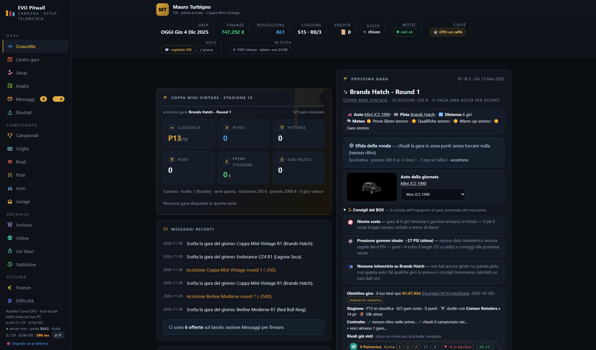
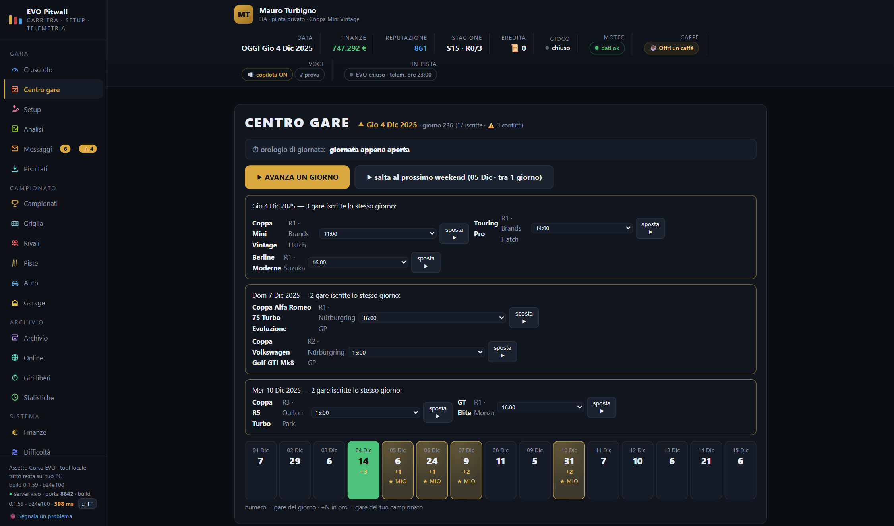
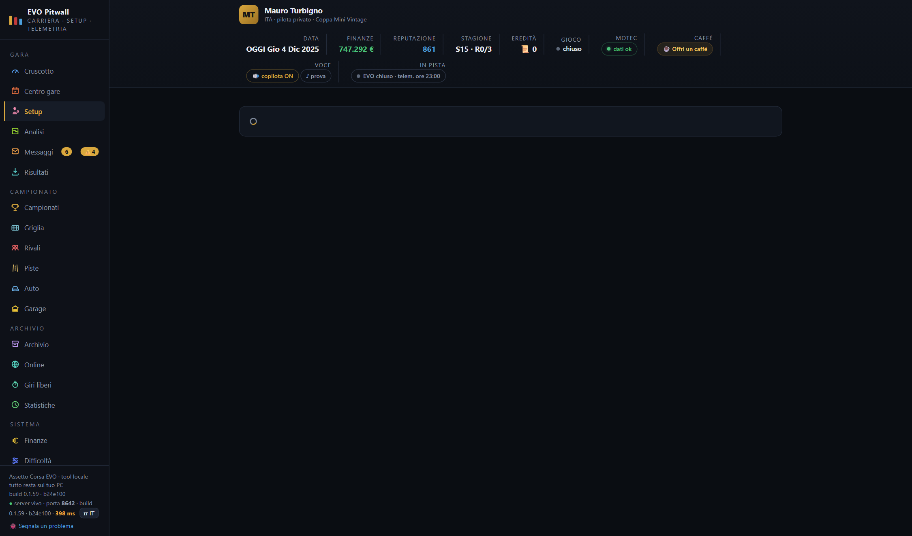
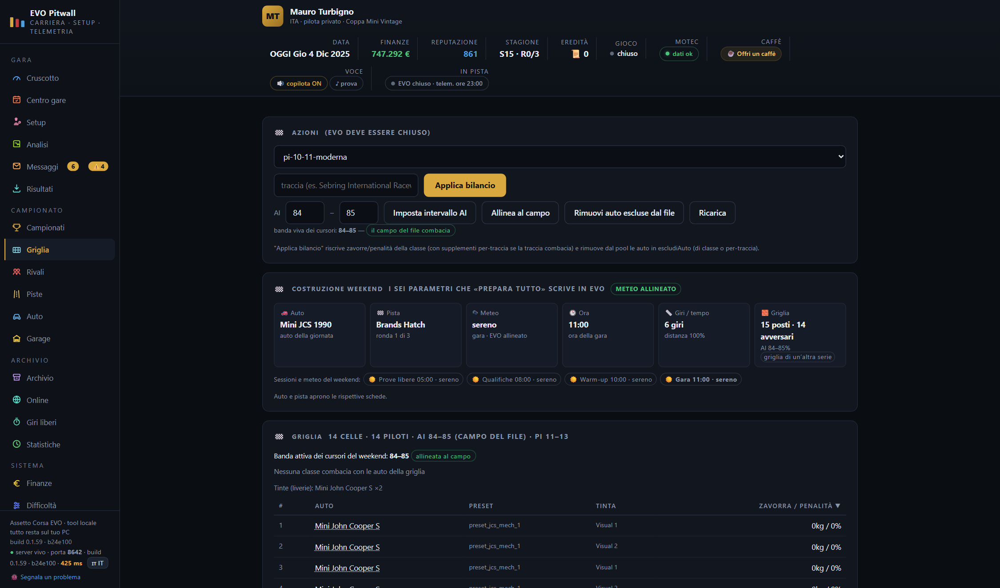
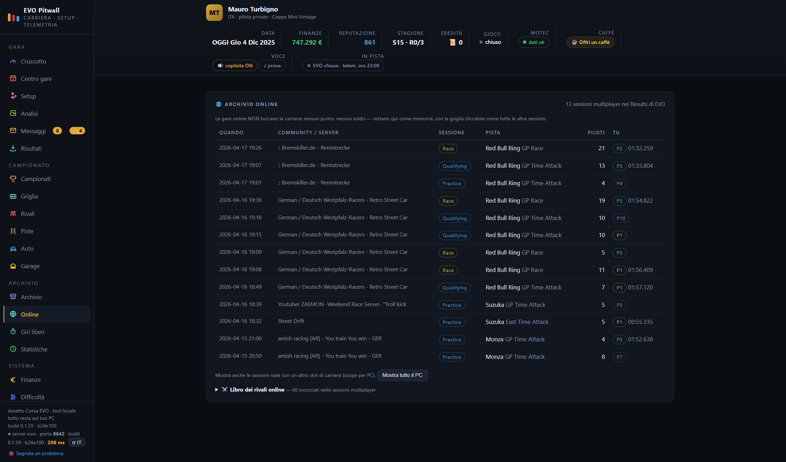
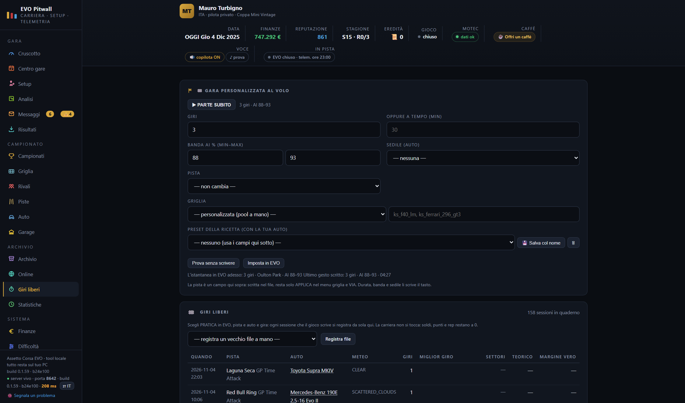

# EVO Pitwall

**A persistent, local-first career for Assetto Corsa EVO.**


[Releases](https://github.com/turbignox-hash/ac-evo-career/releases) · [Italiano](README.it.md) · [Friend guide](GUIDA-AMICO.md) · [Issues](https://github.com/turbignox-hash/ac-evo-career/issues/new) · [Ko-fi](https://ko-fi.com/turbigno)

> **Independent project.** EVO Pitwall is not a content mod, is not affiliated with KUNOS, and does not include code, data, text or graphics from other career apps. It runs on your PC, reads the files Assetto Corsa EVO writes, and keeps the career in a local save.

## What it is

EVO Pitwall adds a career layer *around* Assetto Corsa EVO: a ladder of **86 series across 6 disciplines and 7 levels**, contracts, entry fees, prize money, sponsors, rival drivers, standings, grids, telemetry-driven setup advice and a co-driver radio. It is a local web app (and CLI) that prepares the race weekend, opens the game and reads the native result when the race is over.

The game remains the game. EVO Pitwall does not replace AC EVO's career, does not modify its content, and does not need an account, a cloud service or another career application.

**Current main:** build **0.1.58** · **916 test, 0 fail**s · **374** linted files, 0 warnings.

## Install

### Option A — published friend package

The current **pre-release** is **[v0.1.58](https://github.com/turbignox-hash/ac-evo-career/releases/download/v0.1.58/ac-evo-career-amico-v0.1.58-d3084c9.zip)**. It ships the friend ZIP, both Windows installers and the `EVO-Pitwall-v0.1.58-Windows.zip` bundle with both EXEs, checksums and a short install guide. No administrator rights; the offline EXE includes portable Node and works without a connection.


| Download | What it contains |
| --- | --- |
| **[Windows bundle ZIP](https://github.com/turbignox-hash/ac-evo-career/releases/download/v0.1.58/EVO-Pitwall-v0.1.58-Windows.zip)** | Both EXEs, the two EXE checksums and `LEGGIMI-INSTALLER.txt`; best single download |
| [Offline EXE](https://github.com/turbignox-hash/ac-evo-career/releases/download/v0.1.58/EVO-Pitwall-Setup-Offline.exe) | Self-contained, portable Node and code; no connection |
| [Online EXE](https://github.com/turbignox-hash/ac-evo-career/releases/download/v0.1.58/EVO-Pitwall-Setup.exe) | Downloads portable Node and the current code |
| [Bundle SHA-256](https://github.com/turbignox-hash/ac-evo-career/releases/download/v0.1.58/EVO-Pitwall-v0.1.58-Windows.zip.sha256) | Checksum for the ZIP itself |
| [Friend ZIP](https://github.com/turbignox-hash/ac-evo-career/releases/download/v0.1.58/ac-evo-career-amico-v0.1.58-d3084c9.zip) | Source package with guides and `installa.cmd` |

> **SHA-256:** bundle `7f6f7c92073a95788b97598325d23ab85e2dc4fda06ff00fa77f827be810f060` · online `3313264e7790904953cfc3d90db51741da0d2d0db45a1545ad750f1cee56b8ef` · offline `396fb589262c562cda5e879c0ea78e0f3cafdb952ba6880774d84aa6017818a8`
>
> PowerShell: `Get-FileHash .\EVO-Pitwall-v0.1.58-Windows.zip -Algorithm SHA256`

Re-check the published assets after a release: `npm run verifica-release -- v0.1.58`. GitHub Actions runs the same check for every published release.

> **Unsigned preview:** v0.1.58 is a pre-release because the EXEs are not Authenticode-signed yet. Expect SmartScreen; download only from this repository. v0.1.56 is older.

### Option B — Windows EXE from `main`

From a source checkout:

```bash
npm run installer          # online: downloads Node/code when needed
npm run installer:offline  # offline: embeds portable Node and the code (~40 MB)
```

This produces `dist\EVO-Pitwall-Setup.exe` or `dist\EVO-Pitwall-Setup-Offline.exe`:

- graphical folder picker, install log and **Disinstalla** button;
- no administrator rights, no Git required;
- `--silent --dir <path>` for unattended installs;
- the offline EXE works without a connection; the online one needs internet.

> **Installer status:** both EXEs are attached to the **v0.1.58 pre-release**. They are unsigned; a stable signed release needs an OV or EV certificate.

<details>
<summary>Optional Authenticode signing</summary>

Set `EVO_SIGN_PFX` + `EVO_SIGN_PASSWORD`, or `EVO_SIGN_THUMBPRINT` for a certificate already installed in Windows. The builder finds `signtool.exe` in the Windows SDK (or uses `EVO_SIGNTOOL`), signs with SHA-256 and a timestamp, then writes the `.sha256` of the signed file. `npm run verifica-firma` runs the same checks by hand.

A **self-signed certificate does not remove SmartScreen**: it only helps on a PC that trusts that CA. Removing “Unknown publisher” needs an **OV or EV certificate issued to a verified identity**. Signing alone does not guarantee the warning is gone: SmartScreen also weighs the file hash and download reputation.

</details>

### First launch

1. Install and start **Assetto Corsa EVO** once, so its data folders exist.
2. Run the installer, or extract the friend ZIP and run `installa.cmd`.
3. The GUI opens the signup form; `setup` finds the game paths automatically.
4. The in-game **Cruscotto** and **Pitwall** widgets need the optional [ACE UI App Loader](https://github.com/dreasgrech/ACEUIAppLoader). Without it the rest of the tool still works, and the installer tells you so.

Full walkthrough: [GUIDA-AMICO.md](GUIDA-AMICO.md) (Italian, with an English section) or [FRIEND-GUIDE-EN.md](FRIEND-GUIDE-EN.md).

## v0.1.58 installer preview

This build closes the 4/11 GUI fixes: the Grid tab is alive again, the weekend bulletin no longer has its «Metti» buttons, the Dashboard has one verdict panel, and every screen follows the type floor. It adds the automatic 19-tab check and the static guard on `$(...).forEach`: the two proofs that would have stopped the Grid crash before the commit. The Windows bundle ships both EXEs; the online one downloads Node and the code, the offline one embeds portable Node and the full source. Both are unsigned: expect SmartScreen, this is a pre-release.

## What's new in 0.1.55

- **Windows installer without administrator rights.** A WinForms EXE wraps the same install rules, with a folder picker, log and uninstaller; online and offline variants.
- **Loader warning.** If the ACE UI App Loader is missing, the in-game widgets are skipped with a clear message instead of a silent failure.
- **Release safety.** The release tool stops on a dirty tree, a missing or empty body, a tag that is not on `HEAD` or missing from the remote, and a failed asset upload. The friend package is built only from a completely clean tree.
- **Optional signing preflight.** When signing variables are present, the preflight verifies the Authenticode chain, the `.sha256` sidecar and the build metadata before attaching anything.
- **Independent codebase.** The external journal bridge, the channel and the derived rules are gone. Calendar, garage and dictionary read only files written by the game. A guard test scans the project and fails if a reference to the external product comes back.
- **Current checks:** `npm test` **916/916**, `npm run lint` **372 files, 0 warnings**.

The v0.1.55 notes describe the independence cut; v0.1.58 adds the unsigned installer preview built from clean `main`.

## Highlights

- **A career, not a race generator.** 86 series, 6 disciplines, 7 levels, 18 tracks; gates by position, open/closed seats, per-series economy, real points systems, iconic races, contracts, sponsors and a season duel. The calendar is procedural: named series are the backbone, but new rounds and championships keep appearing over time.
- **Automatic weekend preparation.** The race card knows the track, laps, hour, weather preset, grid and car. “Prepara tutto” writes the weekend; you drive. The car is set automatically once the tool has learned it — an unknown car needs one manual pick in EVO, then the garage/dictionary learns it.
- **Weekend builder at a glance.** The Grid tab shows car, track, weather, hour, laps/time and grid, the weather of every session and a badge telling whether EVO is already aligned, with direct links to the editable race sheet.
- **Endurance and progressive multi-class balance.** Endurance GT4, GT3 Endurance and Endurance Elite bring mixed-class grids; ballast (kg) and time penalties (%) are computed from real results, with per-track confidence and caps. The Grid tab shows the convergence; the system never invents data when the evidence is missing.
- **A mechanic that reads telemetry and writes setups.** Tyre pressures with the 4 PSI rule, camber, ride height, bumpstops, brake bias, TC and fuel per lap, from EVO's `.ld` files where available. It can apply the advice to a new `EVO-consigliato.carsetup` copy next to your setup; load it in EVO while the game is open.
- **Advanced analysis and lap comparison.** Race autopsy, rival dossier, setup A/B bench, best-lap and sector comparison, lap trace and seat Monte Carlo, all built from the files EVO and the tool already write.
- **A co-driver radio, not a chatbot.** One narrator nucleus for the page and the server: flags, fuel, tyres, gaps, pit window, last lap and the chequered flag, with four volume levels (`off`, `essential`, `normal`, `full`).
- **19 tabs.** Dashboard, Race centre, Setup, Messages, Championships, Grid, Rivals, Analysis, Tracks, Cars, Garage, Results, Archive, Online, Free laps, Stats, Finances, Difficulty, Settings. Online sessions are archived without paying career points; Free laps is a separate test-day mode.
- **Bilingual and local.** Italian and English interface, Italian/English CLI via `EVO_LANG`; the local server is bound to `127.0.0.1:8642`. No accounts, no uploads, no cloud.

## Screenshots

| Dashboard | Race centre |
| --- | --- |
|  |  |
| **Setup and telemetry** | **Grid and balance** |
|  |  |
| **Online archive** | **Free laps** |
|  |  |

Live screenshots from a real career save, interface in Italian (switchable to English). The complete tab list is above; the GUI is fully clickable (car names, drivers, tracks, series and header figures all open the matching sheet).

## The race weekend

```text
node ac-evo-career.mjs next      # what's next, and the exact weekend card
node ac-evo-career.mjs race      # pay the entry, mark the round, open EVO
   ... drive ...
node ac-evo-career.mjs import    # read the native result and update the career
```

In the GUI, **Prepara tutto** does the preparation and the watcher imports the result automatically at the end of the race. The car is prepared by the tool; if EVO does not know it yet, pick it once — the tool learns it from the garage and the game menu.

The result is read from EVO's native `Results\*.sessionresults.json`. There is no file injection and no command-line session launch: EVO does not expose one, so the app opens the game and prepares the weekend it already writes.

## Privacy and save safety

- **Everything local.** No account, no telemetry upload, no remote career service. The GUI server listens on `127.0.0.1:8642` and rejects foreign origins.
- **The save is yours.** The career lives in `data/`; updates and friend installs never touch it. The automatic backup keeps a 36-hour rotation of save-only zips in `data/salva-save/`.
- **No game-process patching.** The tool reads files the game writes and prepares the weekend files the game uses; it does not inject code into `AssettoCorsaEVO.exe`.
- **Images.** Official car and track images remain KUNOS property and are not redistributable; see [LICENSE.md](LICENSE.md).

## Limits, stated plainly

- EVO accepts no command-line session launch. The race is prepared through the game's own weekend; the app cannot bypass that.
- The car is automatic only after the tool has learned it; a brand-new car may need one manual pick.
- Dynamic dry↔wet transitions inside a session are not implemented by the game; rounds use fixed weather presets (now planned per session).
- No in-game overlay or VR panel. The optional widgets require the ACE UI App Loader.
- The EXEs are unsigned by default; expect SmartScreen and read the signing note above.
- EVO's native career is untouched; this is a parallel progression.
- The content catalog is observed from the game, not certified; the career save format is versioned.

## Development

Requires **Node.js 18+**. The app has zero runtime dependencies; the test/lint toolchain uses Biome and Playwright Core.

```bash
npm install
npm test
npm run lint
npm run check
```

Build the installers:

```bash
npm run installer
npm run installer:offline
```

The test suite runs entirely in sandboxes and never touches the real game files. The project is plain ESM: `src/` (career, results, web UI, telemetry), `gui/` (browser interface), `uiapp/` (in-game widgets), `config/` (the ladder), `test/` and `tools/` (installer, release, calibration and maintenance).

Release tooling lives in `tools/crea-release.mjs`, `tools/pacchetto-amico.mjs` and `tools/release-assets.mjs`; the checklist is [RELEASE_CHECKLIST.md](RELEASE_CHECKLIST.md).

## License

**© 2026 Mauro Turbigno — all rights reserved.** This is a private work: no redistribution, publication, resale or incorporation into other products without written permission. Assetto Corsa EVO is a KUNOS Simulazioni product; this project is not affiliated with or endorsed by KUNOS. The full text is in [LICENSE.md](LICENSE.md).

## Links

- [Issues and ideas](https://github.com/turbignox-hash/ac-evo-career/issues/new)
- [Releases](https://github.com/turbignox-hash/ac-evo-career/releases)
- [Changelog](CHANGELOG.md)
- [Italian README](README.it.md)
- [Friend guide — Italian](GUIDA-AMICO.md) · [Friend guide — English](FRIEND-GUIDE-EN.md)
- [Ko-fi](https://ko-fi.com/turbigno)
